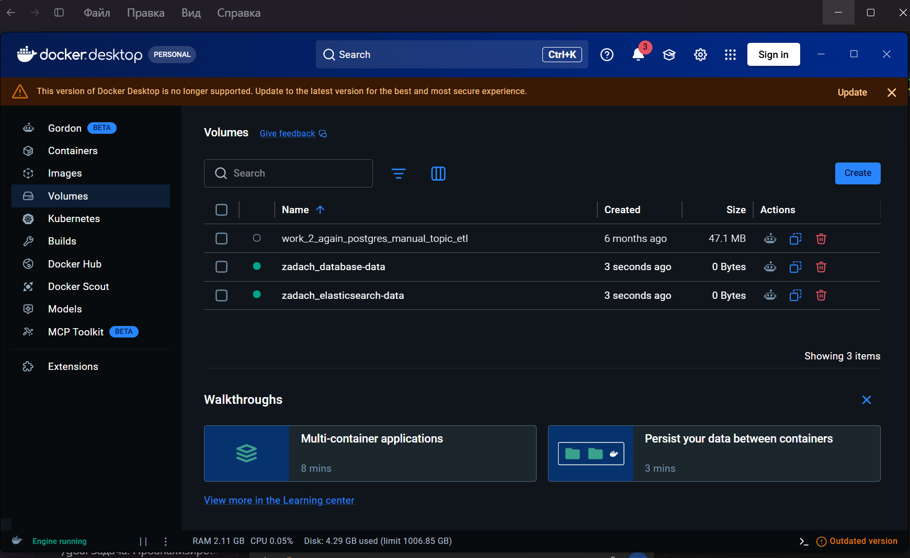

# Поиск по документам

Сервис ищет документы по текстовому запросу и возвращает до 20 совпадений,
начиная с самых новых. Документ можно удалить по id: запись удаляется из базы
и поискового индекса.

API написан на FastAPI, данные хранятся в SQLite, поиск выполняет Elasticsearch.
Все обращения к хранилищам асинхронные. Для запуска из исходников нужен Python 3.12.

## Устройство проекта

| Файл | Назначение |
| --- | --- |
| `app/main.py` | HTTP-методы, проверка запроса и обработка ошибок |
| `app/service.py` | Поиск самых новых документов и порядок удаления |
| `app/repository.py` | Чтение и запись полных документов в SQLite |
| `app/search.py` | Поисковый индекс, scroll и пакетная загрузка |
| `app/import_csv.py` | Проверка и импорт CSV |
| `app/config.py` | Настройки из переменных окружения |
| `tests/` | Проверки API, импорта и работы с Elasticsearch |

В SQLite у документа четыре поля: `id`, `rubrics`, `text`, `created_date`.
В Elasticsearch сохраняются только `id` и `text`, как указано в задании.

## Запуск в Docker

Для Windows есть [EXE в Releases](https://github.com/Andrey222334/document-research-Rayan/releases).
Порядок запуска и сборки описан в [инструкции для Windows](docs/windows.md).
EXE включает Python и зависимости сервиса; Elasticsearch нужен отдельно.

Нужны Docker Engine и Docker Compose; на Windows — запущенный Docker Desktop
с Linux-контейнерами. Выделите Docker минимум 2 ГБ памяти.

1. Скачайте [исходный CSV](https://disk.yandex.ru/d/UYooXd9q2yqTMQ)
   и сохраните как `data/posts.csv` (создайте каталог `data`).
2. Запустите сервисы из каталога проекта:

   ```shell
   docker compose up --build -d
   ```

3. Дождитесь запуска API и импортируйте документы:

   ```shell
   docker compose run --rm api python -m app.import_csv /input/posts.csv
   ```

4. Откройте Swagger UI: <http://localhost:8000/docs>.
   OpenAPI доступен в `docs.json` и на <http://localhost:8000/openapi.json>.

Данные сохраняются в Docker volumes. Остановка: `docker compose down`.
Команда `docker compose down -v` **удаляет все данные**.

В Docker Desktop эти хранилища видны на вкладке **Volumes**. На снимке ниже
`zadach_database-data` относится к SQLite, а `zadach_elasticsearch-data` —
к поисковому индексу. Префикс зависит от имени папки, из которой запущен Compose.



Elasticsearch без авторизации и порты доступны только на localhost: это
конфигурация для локального тестового задания.

## API

### Поиск

```shell
curl --get http://localhost:8000/documents --data-urlencode "q=информация"
```

Ответ `200` — JSON-массив максимум из 20 документов с полями `id`, `rubrics`,
`text`, `created_date`. Сначала самые новые; при одинаковой дате — меньший `id`.
Если совпадений нет, ответ `[]`. Отсутствующий, пустой или пробельный запрос —
`422`; максимальная длина запроса — 10 000 символов.

Поиск использует Elasticsearch `match` и русский анализатор. Запрос из нескольких
слов находит документы, содержащие хотя бы одно из них. Учитываются формы русских
слов; отдельный фрагмент внутри слова может не дать совпадений.
Индекс не содержит дат, поэтому сервис читает **все** совпавшие идентификаторы
через scroll, получает документы порциями из SQLite и сохраняет глобальные
20 самых новых. Объём памяти при поиске ограничен размером порции, но время
зависит от числа совпадений. Такой способ подходит для исходных 1500 записей.
Для большого массива стоит добавить дату в индекс и сортировать на стороне
Elasticsearch — здесь это изменило бы заданную структуру индекса.

### Удаление

```shell
curl -X DELETE http://localhost:8000/documents/1
```

`204` без тела после удаления из обоих хранилищ; `404`, если документа нет
ни в одном; `422` для некорректного или неположительного id.
При недоступности хранилища API возвращает `503`.

У двух хранилищ нет общей транзакции. Сначала удаляется запись индекса,
затем SQLite. Если Elasticsearch недоступен, исходный документ сохраняется.
Если SQLite откажет после удаления из индекса, повторите DELETE: отсутствующая
запись индекса не препятствует удалению из SQLite. При конкурентном поиске
ответ может отражать состояние до удаления.

## Импорт

Поддерживается UTF-8 CSV с колонками `text,created_date,rubrics`, включая
многострочные тексты. Рубрики в исходном файле представлены Python-списками;
они безопасно разбираются через `ast.literal_eval` и проверяются.
Весь файл валидируется до начала записи.

В исходном CSV нет id: используется номер записи начиная с 1. Даты без
часового пояса считаются UTC, даты с поясом приводятся к UTC. Результаты API
содержат часовой пояс. Импорт одного и того же файла повторяем: записи
перезаписываются по стабильному id. Запись идёт порциями по 500 документов;
сначала SQLite, затем индекс. При ошибке повторите импорт того же файла.

Импорт предназначен для одного фиксированного массива. Другой порядок строк
меняет соответствие id; более короткий файл не удаляет старые записи.
Повторный импорт восстановит ранее удалённые документы. Не выполняйте импорт
одновременно с DELETE; для смены массива используйте чистые хранилища.

CSV не включён в образ и исключён из Git.

## Локальная разработка

```powershell
python -m venv .venv
.\.venv\Scripts\python -m pip install -r requirements-dev.txt
docker compose up -d elasticsearch
.\.venv\Scripts\python -m app.import_csv data/posts.csv
.\.venv\Scripts\python -m uvicorn app.main:app --reload
```

Linux/macOS: используйте `.venv/bin/python` вместо Windows-пути.

Переменные окружения:

| Переменная | По умолчанию |
| --- | --- |
| `DATABASE_PATH` | `data/documents.db` |
| `ELASTICSEARCH_URL` | `http://localhost:9200` |
| `ELASTICSEARCH_INDEX` | `documents` |

## Тесты

HTTP-тесты используют настоящую временную SQLite и заменяют только Elasticsearch:

```powershell
.\.venv\Scripts\python -m pytest -m "not integration" -q
```

Проверяются глобальный лимит и порядок дат между порциями, все поля ответа,
валидация, отсутствие совпадений, удаление, отказ индекса и повторное удаление
при частичной рассинхронизации, импорт многострочного CSV и неверные рубрики.

Интеграционный тест использует настоящий Elasticsearch, временную SQLite и
уникальный индекс, удаляемый после теста:

```powershell
docker compose up -d elasticsearch
$env:RUN_INTEGRATION = "1"
.\.venv\Scripts\python -m pytest -m integration -q
```

Linux/macOS: `RUN_INTEGRATION=1 .venv/bin/python -m pytest -m integration -q`.
Проверяются повторный импорт, русская морфология, порядок результатов и удаление
из обоих хранилищ. Без `RUN_INTEGRATION=1` тест явно пропускается.

Обновление статической OpenAPI после изменения API:

```shell
python -c "import json; from pathlib import Path; from app.main import app; Path('docs.json').write_text(json.dumps(app.openapi(), ensure_ascii=False, indent=2) + '\n', encoding='utf-8')"
```

Зависимости: FastAPI/Pydantic — API и валидация; Uvicorn — ASGI-сервер;
aiosqlite — SQLite без блокировки цикла событий; официальный асинхронный
Elasticsearch-клиент — индекс и scroll. pytest, pytest-asyncio и HTTPX нужны
только для проверок.
